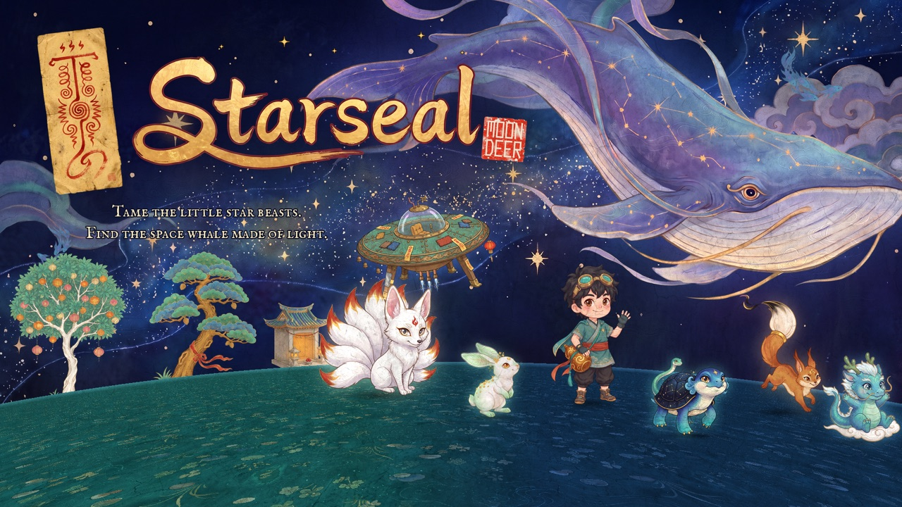

# Unreal Director

**Make games agentically with Unreal Engine without even opening Unreal Editor.**

AI coding agents cannot click through the Unreal Editor, watch a play session or drag an asset into a folder.
unreal-director is the set of scripts, skills, conventions and hard-won notes that replaces each of those clicks with
something an agent can do: code, editor Python run headlessly, command-line packaging, self-playing builds that
print what happens, and screenshots the agent checks itself.

## What's inside

```
scripts/
  web/      Playwright tests of the packaged Wasm build (headless, real GPU)
  native/   off-screen native runs, a mouse guard, fixed-step video recording
  import/   editor-Python asset import and node-by-node material building
  build/    command-line Wasm packaging, upload checks, itch.io push
  qc/       contact sheets, frame-cadence and one-frame-glitch checks, video mixing, package size
skills/     Claude Code skills that chain the scripts into workflows
guides/     what we learned, per topic (start with log-protocol.md)
reference/  C++ excerpts from Starseal: the autoplay switches and log protocol the scripts rely on
```

| Tool | What it does |
|---|---|
| `web/autoplay_web.py` | Serves the build, plays it to the end with the game's autoplay switch, screenshots every named moment, fps per state |
| `web/input_steps_web.py` | Real clicks and keys from a JSON step list; each step waits for the log line that proves the game reacted |
| `web/isolation_test_web.py` | Proves the build starts on a host that sends no COOP / COEP headers |
| `web/cover_test_web.py`, `web/gpu_message_test_web.py` | First-time player flow; what a player without WebGPU sees |
| `native/autoplay_native.py`, `native/record_native.py` | Off-screen native play-through; 1080p video with re-mixed sound, no screen recording |
| `native/mouse_guard.py` | Kills a test run that pins your cursor or steals focus, so you can keep working |
| `import/ue_import.py`, `import/import_manifest.py` | PNG / GLB / WAV through Interchange and materials built in Python, from a JSON manifest |
| `build/package_wasm.sh` | `BuildCookRun` for Wasm Shipping with the settings that worked |
| `build/prepare_web_upload.py` | Size limits without `.br`, the itch.io service-worker header fix, a clean zip |
| `build/itch_push.sh` | butler push that skips `.br` files |
| `qc/contact_sheet.py`, `qc/qc_cadence.py`, `qc/presence_check.py` | Find what to look at; stutter in a video; a character missing for one frame |
| `qc/make_video.py`, `qc/pkg_size.py` | Frames + audio events to MP4 and rough cuts; what takes the space in a package |

Skills: `wasm-package-and-test`, `headless-import`, `playtest-qa`.
Guides: [log protocol](guides/log-protocol.md), [packaging](guides/packaging-wasm.md),
[itch.io](guides/itch-deploy.md), [headless import](guides/headless-import.md),
[playtesting](guides/playtesting.md), [screenshot QA](guides/screenshot-qa.md), [gotchas](guides/gotchas.md).

## Example usage

You play the build and say what is wrong in plain words. The agent turns that into code, a new build and proof.

> **You:** In battle, everything should stand still. The tortoise's snake head slides out of the frame and the fox's
> tails look off. Also, Space should pause the opening film, not skip it.

What the agent does with this repo:

1. **Changes the code.** Turns off the idle motion in the creature and hero `Tick`, and rebinds Space in the intro.
2. **Packages without the editor.** The `wasm-package-and-test` skill runs `build/package_wasm.sh`, then
   `build/prepare_web_upload.py` to check the size limits and the service-worker headers.
3. **Plays the build itself.** `web/autoplay_web.py` runs the game to the end with its autoplay switch, waits for
   the log lines that prove each state was reached, and takes a screenshot at every named moment, battles included.
   `web/input_steps_web.py` presses Space during the film and waits for the log line that says the film paused, not that it ended.
4. **Looks at the result.** `qc/contact_sheet.py` shows where to look; the agent then opens those screenshots at full
   size and compares frames, so a moving head shows up as a difference.
5. **Reports back** with the screenshots, the package size and what it could not check, and pushes the build to
   itch.io with `build/itch_push.sh` once you say go.

In Starseal, the code changes and the new package for six notes like these took about 20 minutes. Nobody opened
the editor.

## Made with it: Starseal

[](https://neozax.itch.io/starseal)

**Starseal** was made in 4 days for the 2026 Epic AI MegaJam with Claude Code agents, in UE 5.9, shipped to the
browser (Wasm + WebGPU). Unreal Editor was never opened once during the entire process. ([Play link](https://neozax.itch.io/starseal))

## Quick start

Prerequisites:

- Unreal Engine 5.9 and a C++ project. The launcher build is enough for headless import, native playtests and the
  QC tools.
- **For web builds only:** Unreal Engine 5.9 **built from source** (the Wasm platform is not in the launcher build)
  and emsdk at the version the engine asks for. This is needed by `scripts/web/` and `scripts/build/`.
- Python 3.10+ (`pip install -r requirements.txt`, then `playwright install chromium`), ffmpeg for the video tools.
- Node.js (Playwright's runtime), and [Claude Code](https://claude.com/claude-code) or another agent to drive it.

```bash
export UE=/path/to/UnrealEngine UPROJECT=/path/to/MyGame.uproject
export WASM_EMSDK_ROOT=/path/to/emsdk   # web builds only

# 1. give the game an autoplay switch and the log lines: guides/log-protocol.md, reference/
# 2. import assets without the editor
UD_MANIFEST=$PWD/assets.json "$UE/Engine/Binaries/Mac/UnrealEditor.app/Contents/MacOS/UnrealEditor" "$UPROJECT" \
  -run=pythonscript -script=$PWD/scripts/import/import_manifest.py -unattended -nopause -nosplash -nullrhi
# 3. (web) package for the browser, check it, play it
scripts/build/package_wasm.sh "$UPROJECT" /Game/MyGame/Maps/Main $PWD/Builds/MyGame_Wasm
python3 scripts/build/prepare_web_upload.py Builds/MyGame_Wasm/Wasm --patch-sw
python3 scripts/web/autoplay_web.py --stage Builds/MyGame_Wasm/Wasm --out runs/web --require Title,Ending
python3 scripts/qc/contact_sheet.py runs/web/sheet.png runs/web/*.png
```

To use the skills, copy (or symlink) `skills/<name>` into your project's `.claude/skills/`.

## Status

Extracted from a 4-day jam project. Tested on UE 5.9 + Wasm (WebGPU) on macOS. Some scripts assume a Mac (paths of the editor binary, the mouse guard).

## License

MIT. See [LICENSE](LICENSE).
